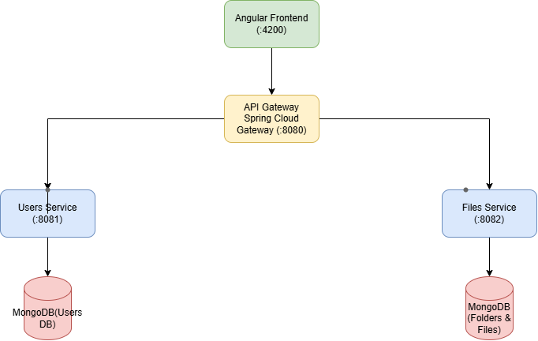
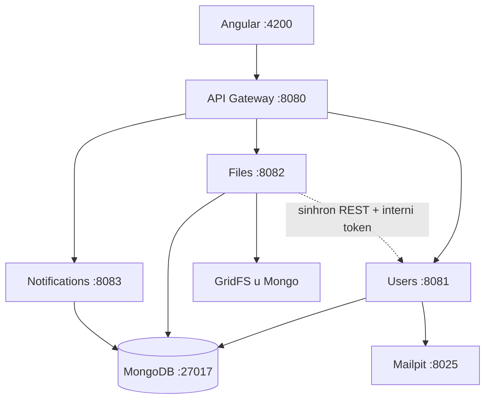

# Cloud Drive — mikroservisna platforma za skladištenje fajlova

**Tim:** Rastko, Nataša, Filip  
**Tehnologije:** Angular, Spring Boot, Spring Cloud Gateway, MongoDB, Docker Compose

Mikroservisni sistem sličan Google Drive-u: registracija, prijava, folderi, otpremanje datoteka, notifikacije i sinhrona provera kvote. 

---

## 1. Pregled

Korisnik se registruje i potvrdi nalog putem koda sa emaila, prijavljuje se lozinkom i OTP kodom, zatim pravi foldere, otprema datoteke i vidi notifikacije. **Klijentska aplikacija (Angular)** ne zove mikroservise direktno nego isključivo **API Gateway** na portu **8080**

---

## 2. Arhitektura





**Sinhrona komunikacija (2.5):** pre snimanja datoteke **Files** poziva **Users** (interni API za kvotu) da proveri i ažurira zauzeće skladišta.

Detaljniji dijagram: [`docs/DIJAGRAM-2.1.md`](./docs/DIJAGRAM-2.1.md).

---

## 3. Servisi i portovi

| Port | Komponenta |
|------|------------|
| 4200 | Angular (u Dockeru: nginx) |
| 8080 | API Gateway |
| 8081 | Users servis |
| 8082 | Files servis |
| 8083 | Notifications servis |
| 27017 | MongoDB |
| 8025 | Mailpit (web UI — pregled OTP / kodova) |
| 1025 | Mailpit (SMTP) |

| Servis            | Odgovornost                                                                                                            |
| ----------------- | ---------------------------------------------------------------------------------------------------------------------- |
| **Users**         | Registracija, potvrda registracije, prijava, OTP, odjava, promena/reset lozinke, kvota korisnika, interni API za Files |
| **Files**         | Folderi (hijerarhija), metapodaci datoteka, upload i nove verzije, sadržaj u GridFS                                    |
| **Notifications** | Čitanje liste notifikacija                                                                                             |
| **Gateway**       | Jedinstven ulaz, REST rute, CORS ka `http://localhost:4200`                                                            |

Servisi **Sharing**, **Analytics**, message broker i ostali iz pune specifikacije **nisu deo opsega ocene 6** u ovom projektu.

---

## 4. API Gateway — rute (2.2)

Konfiguracija: `gateway-service/src/main/resources/application.yml`

| Prefix | Servis |
|--------|--------|
| `/api/users/**` | Users |
| `/api/folderi/**` | Files |
| `/api/fajlovi/**` | Files |
| `/api/notifikacije/**` | Notifications |

Adrese backend servisa (`USERS_SERVICE_URL`, `FILES_SERVICE_URL`, …) dolaze iz **environment promenljivih** u Docker Compose, ne iz zakucanih vrednosti u kodu.

---

## 5. MongoDB — baze i kolekcije (NoSQL)

Jedan MongoDB kontejner, **više baza**:

### `users_db`

- Kolekcija `users`: email, heširana lozinka (BCrypt), ime, prezime, `kvotaSkladista`, `zauzetoSkladiste`, polja za potvrdu registracije, OTP, reset lozinke, `datumPromeneLozinke`, `verifikovan`, itd.
- Kolekcija `zahtevi_kvota`: zahtevi za povećanje kvote

### `files_db`

- `folderi`: `naziv`, `vlasnikId`, `roditeljId` (`null` = korenski folder), vremenske oznake.
- `datoteke`: `naziv`, tip, veličina, `vlasnikId`, `folderId`, referenca na GridFS, verzija / datum izmene.
- **GridFS**: binarni sadržaj datoteka (object storage unutar MongoDB).

### `notifikacije_db`

- `notifikacije`: `email` korisnika, `poruka`, `vremeKreiranja` (i opciona polja).

---

## 6. Komunikacija

| Od → ka | Način | Primer |
|---------|--------|--------|
| Angular → Gateway | REST, JSON | `http://localhost:8080/api/...` |
| Gateway → Users / Files / Notifications | REST (prosleđivanje) | po rutama iz tabele |
| Files → Users | **Sinhron REST** | interni kvota API + zaglavlje `X-Internal-Token` |

---

## 7. Pokretanje

### Docker Compose

```bash
docker compose up -d --build
```

Servisi u `docker-compose.yml`: **mongo**, **users-service**, **files-service**, **notifications-service**, **gateway-service**, **frontend**, **mailpit**.

### Aplikacija

- Frontend: **http://localhost:4200**
- Mailpit (OTP / kodovi): **http://localhost:8025**

---

## 8. Repozitorijum — struktura

```
cloud-drive-microservices/
├── frontend/              # Angular klijent
├── gateway-service/       # API Gateway
├── users-service/         # Korisnici, autentifikacija, kvota
├── files-service/         # Folderi, datoteke, GridFS
├── notifications-service/ # Lista notifikacija
├── docker-compose.yml
├── .env.example
├── docs/
├── arhitektura-sistema.png
└── README.md
```

---