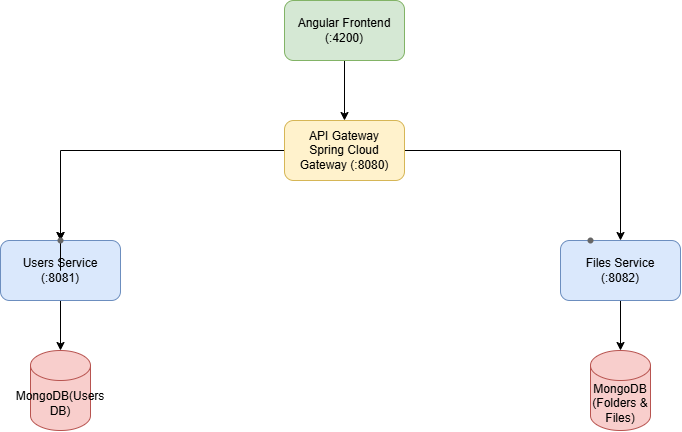
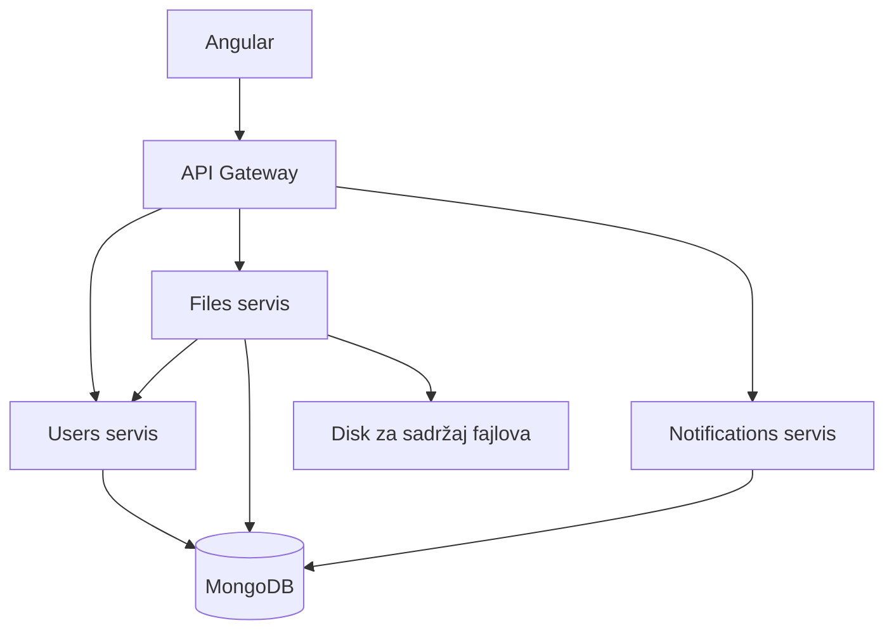

# Cloud Drive — dizajn sistema

Predmet: MRS, ocena 6  
Tim: Rastko, Nataša, Filip  
Tehnologije: Angular, Spring Boot, MongoDB, Docker Compose

Dokument je za zahtev 2.1 (dizajn). Opisuje kako planiramo da složimo sistem pre nego što sve bude implementirano.

---

## 1. Šta pravimo

Web aplikacija za čuvanje fajlova (slično Drive-u). Korisnik se registruje, ima kvotu, pravi foldere, uploaduje fajlove. Frontend je Angular. Posao je podeljen na mikroservise; klijent ne zove svaki servis posebno nego ide kroz API Gateway.

---

## 2. Dijagram

Napomena: linija files → users je sinhroni poziv (provera kvote pre uploada).

---

## 3. Servisi i portovi

Angular — 4200  
API Gateway — 8080  
Users — 8081  
Files — 8082  
Notifications — 8083  
MongoDB — 27017  

Users: registracija, prijava, OTP, lozinke, kvota, admin deo oko kvote.  
Files: folderi, upload, verzije, preimenovanje, metapodaci u bazi a bajti na disku.  
Notifications: lista obaveštenja za korisnika (za ocenu 6 može ručno u bazi).  
Gateway: rutiranje i kasnije JWT (informaciona bezbednost).

Foldere i fajlove drži samo Files servis.

---

## 4. MongoDB — šta čuvamo

Users baza, kolekcija korisnika: email, hash lozinke, ime, prezime, kvota i zauzeće, polja za OTP i reset lozinke, datum promene lozinke.

Files baza:  
- folderi — naziv, vlasnikId, roditeljId (null je koren), datum  
- datoteke — naziv, tip, veličina, vlasnikId, folderId, putanja na disku, verzija  

Notifications baza: notifikacije — korisnikId, poruka, procitano, datum.

---

## 5. Komunikacija

Klijent i gateway: REST, JSON.  
Gateway prosleđuje na odgovarajući servis.  
Files i Users: REST između servisa (npr. da li ima mesta na disku pre snimanja fajla). Za ocenu 6 ne planiramo message broker.

---

## 6. API — grubo

Korisnici (Users): registracija, potvrda mailom, prijava, OTP, odjava, promena i reset lozinke, magični link, zahtev za kvotu, admin odobravanje.

Folderi i fajlovi (Files): kreiranje foldera, pregled sadržaja foldera, preimenovanje, upload, nova verzija fajla.

Notifikacije: GET lista za ulogovanog korisnika.

Tačne putanje držimo u kodu kad krenemo implementaciju; u specifikaciji su povezane sa tačkama 1.1–1.8 i 1.4–1.7.

---

## 7. Gateway — rute (ideja)

/api/korisnici/** → Users  
/api/folderi/** i /api/fajlovi/** → Files  
/api/notifikacije/** → Notifications  

Konfiguracija preko application.yml i env promenljivih (2.4), ne fiksno u kodu.

---

## 8. Docker

Jedan docker-compose: Mongo i svi servisi kada budu gotovi. Metapodaci u Mongo, fajlovi u volume/folderu na Files servisu.

---

## 9. Povezivanje sa specifikacijom (ocena 6)

2.1 — ovaj dokument i dijagram  
2.2 — API Gateway  
2.3 — Docker Compose  
2.4 — spoljašnja konfiguracija  
2.5 — sinhroni poziv Files → Users (kvota)  
1.1–1.3, 1.8 — Users i Angular  
1.4–1.6, 1.5 — Files i Angular  
1.7 — Notifications  

Informaciona bezbednost (JWT, validacija, BCrypt) — Users, gateway i deo na klijentu.

---

Kraj dokumenta — verzija za predaju dizajna.
