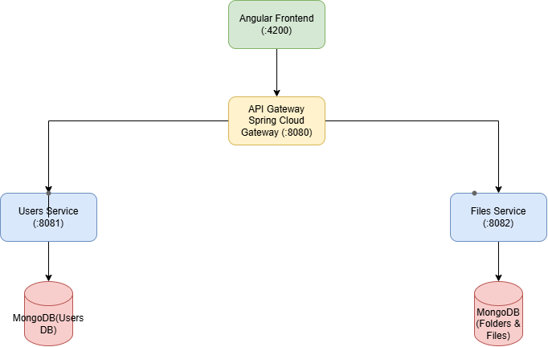

# Cloud Drive - Dokumentacija Dizajna Sistema (Task 2.1)

Ovaj dokument sadrzi arhitektonski nacrt i specifikaciju mikroservisne aplikacije za skladistenje i deljenje fajlova (Cloud Drive).

---

## 1. Arhitektura sistema (High-Level Architecture)

Sistem je zasnovan na mikroservisnoj arhitekturi. Centralna ulazna tacka za sve klijentske zahteve je **API Gateway**, koji vrsi rutiranje saobracaja ka odgovarajucim mikroservisima.

### Komponente i tehnicka specifikacija:
* **Klijentska aplikacija (Frontend):** Angular (Port `:4200`)
* **API Gateway:** Spring Cloud Gateway (Port `:8080`)
* **Users Service:** Spring Boot (Port `:8081`)
  * Baza podataka: **MongoDB** (`Users DB`)
* **Files Service:** Spring Boot (Port `:8082`)
  * Baza podataka: **MongoDB** (`Folders & Files DB`)

---

## 2. Modeli podataka (Entiteti)

### A. Users Service (`Users DB`)
* **`User` (Korisnik):**
  * `id` (String / ObjectId) - Jedinstveni identifikator korisnika
  * `email` (String) - Jedinstvena imejl adresa korisnika
  * `lozinka` (String) - BCrypt hesirana lozinka
  * `ime` (String) - Ime korisnika
  * `prezime` (String) - Prezime korisnika
  * `kvotaSkladista` (Long) - Ukupna dodeljena kvota u bajtovima
  * `zauzetoSkladiste` (Long) - Trenutno iskoriscen prostor u bajtovima

### B. Files Service (`Folders & Files DB`)
* **`Folder` (Folder):**
  * `id` (String / ObjectId) - Jedinstveni identifikator foldera
  * `naziv` (String) - Naziv foldera
  * `vlasnikId` (String) - ID korisnika koji je vlasnik foldera
  * `roditeljId` (String) - ID nadredjenog foldera (`null` za korenski folder)
  * `datumKreiranja` (LocalDateTime) - Vreme kreiranja foldera

* **`File` (Datoteka - metapodaci):**
  * `id` (String / ObjectId) - Jedinstveni identifikator datoteke
  * `naziv` (String) - Naziv datoteke sa ekstenzijom
  * `tip` (String) - MIME tip datoteke
  * `velicina` (Long) - Velicina datoteke u bajtovima
  * `vlasnikId` (String) - ID korisnika koji je vlasnik datoteke
  * `folderId` (String) - ID foldera u kom se datoteka nalazi
  * `vremeIzmene` (LocalDateTime) - Datum i vreme poslednje izmene/verzije

---

## 3. Stilovi komunikacije izmedju servisa

1. **Klijent <-> API Gateway:** 
   * Eksterna komunikacija se odvija putem **REST API** protokola prenosom JSON podataka preko HTTP/HTTPS protokola.
2. **API Gateway <-> Mikroservisi:** 
   * API Gateway sinhrono prosledjuje klijentske zahteve na odgovarajuce endpointe `Users` i `Files` servisa na osnovu definisanih ruta.
3. **Medjuservisna komunikacija (Sinhrona):**
   * Primenjuje se sinhrona HTTP komunikacija (koriscenjem Spring Cloud OpenFeign-a ili RestTemplate-a). 
   * *Primer:* Prilikom otpremanja nove datoteke, `Files` servis sinhrono upucuje poziv ka `Users` servisu radi provere i validacije preostale kvote skladista korisnika.