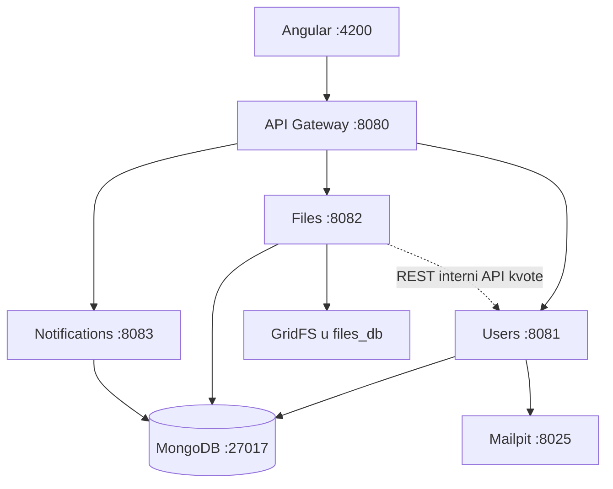

# Cloud Drive

**Tim:** Rastko, Nataša, Filip  
**Tehnologije:** Angular, Spring Boot, Spring Cloud Gateway, MongoDB, Docker Compose

Web aplikacija za skladištenje fajlova u duhu Google Drive-a: registracija i prijava sa kodom na mailu, folderi, upload i verzije fajlova, pregled kvote i lista notifikacija. Backend je podeljen na nekoliko mikroservisa; podaci su u MongoDB-u.

---

## Pregled

Korisnik se registruje, potvrdi nalog kodom iz emaila, zatim se prijavi lozinkom i OTP kodom. U aplikaciji pravi foldere, otprema datoteke i pregleda obaveštenja. Pre uploada sistem proverava da li na nalogu ima dovoljno prostora — to radi tako što **Files** servis pozove **Users** servis i ažurira zauzeće memorije.

Svi REST pozivi sa fronta idu na **API Gateway** (`http://localhost:8080`); on prosleđuje zahteve na odgovarajući mikroservis.

---

## Arhitektura



Dijagram komponenti (portovi, baze, komunikacija): [`docs/DIJAGRAM-2.1.md`](./docs/DIJAGRAM-2.1.md).

---

## Servisi i portovi

| Port | Komponenta |
|------|------------|
| 4200 | Angular (u Dockeru: nginx) |
| 8080 | API Gateway |
| 8081 | Users |
| 8082 | Files |
| 8083 | Notifications |
| 27017 | MongoDB |
| 8025 | Mailpit (pregled poruka) |
| 1025 | Mailpit (SMTP) |

| Servis | Uloga |
|--------|--------|
| **Users** | Nalozi, registracija, prijava, OTP, lozinka, kvota na profilu, zahtevi za povećanje kvote, interni API za Files |
| **Files** | Folderi, metapodaci datoteka, upload i nova verzija, sadržaj u GridFS |
| **Notifications** | Lista notifikacija po emailu |
| **Gateway** | Jedinstven ulaz za REST, prosleđivanje na odgovarajući servis, CORS za `http://localhost:4200` |

---

## API Gateway — rutiranje

Konfiguracija: `gateway-service/src/main/resources/application.yml`

| Prefiks putanje | Odredište |
|-----------------|-----------|
| `/api/users/**` | Users (8081) |
| `/api/folderi/**` | Files (8082) |
| `/api/fajlovi/**` | Files (8082) |
| `/api/notifikacije/**` | Notifications (8083) |

URL-ovi servisa unutar Dockera (`USERS_SERVICE_URL`, `FILES_SERVICE_URL`, …) dolaze iz `docker-compose.yml` i `.env`, ne iz zakucanih vrednosti u Javi.

---

## Model podataka

Jedan MongoDB proces, **odvojene baze** po servisu. U kodu entiteti su u paketima `model` sa anotacijom `@Document`.

### Users — baza `users_db`

**Korisnik** (`users`)

| Polje | Značenje |
|-------|----------|
| `id` | Jedinstveni identifikator |
| `email` | Email naloga |
| `lozinka` | Heš lozinke (BCrypt) |
| `ime`, `prezime` | Podaci korisnika |
| `kvotaSkladista` | Ukupno dozvoljeno mesto (bajti) |
| `zauzetoSkladiste` | Trenutno zauzeto mesto (bajti) |
| `admin` | Da li je administrator |
| `verifikovan` | Da li je potvrđena registracija |
| `kodPotvrdeRegistracije`, `kodPotvrdeIstice`, `brojPokusajaPotvrde` | Potvrda registracije |
| `otpKod`, `otpIstice`, `brojOtpPokusaja` | OTP pri prijavi |
| `datumPromeneLozinke`, `blokiranDo` | Politika starosti lozinke i blokada |
| `tokenResetLozinke`, `tokenResetIstice` | Reset lozinke |

**Zahtev za kvotu** (`zahtevi_kvota`)

| Polje | Značenje |
|-------|----------|
| `id` | Identifikator zahteva |
| `korisnikId` | Referenca na korisnika |
| `emailKorisnika` | Email podnosioca |
| `zeljenaKvota` | Tražena kvota (bajti) |
| `status` | Stanje zahteva |
| `kreiran` | Datum i vreme kreiranja |

### Files — baza `files_db`

**Folder** (`folderi`)

| Polje | Značenje |
|-------|----------|
| `id` | Identifikator foldera |
| `naziv` | Naziv |
| `vlasnikId` | ID korisnika (`users.id`) |
| `roditeljId` | Nadfolder; `null` je koren |
| `datumKreiranja` | Vreme kreiranja |

**Datoteka** (`datoteke`)

| Polje | Značenje |
|-------|----------|
| `id` | Identifikator zapisa |
| `naziv` | Ime fajla |
| `tip` | MIME tip |
| `velicina` | Veličina u bajtovima |
| `vlasnikId` | ID korisnika |
| `folderId` | ID foldera |
| `gridFsId` | Pokazivač na sadržaj u GridFS |
| `vremeIzmene` | Poslednja izmena |

**GridFS** — binarni sadržaj fajlova unutar iste baze; u aplikaciji se koristi preko `gridFsId` na entitetu Datoteka.

### Notifications — baza `notifikacije_db`

**Notifikacija** (`notifikacije`)

| Polje | Značenje |
|-------|----------|
| `id` | Identifikator |
| `email` | Korisnik kom je poruka namenjena |
| `poruka` | Tekst obaveštenja |
| `vremeKreiranja` | Vreme nastanka |

### Gateway i front

Gateway **nema** sopstvenu bazu — samo rutira zahteve. Angular ne definiše Mongo entitete; prikazuje JSON sa API-ja i u `localStorage` drži `userId` i `userEmail` radi poziva ka Files servisu.

---

## Komunikacija između komponenti

| Od | Ka | Način | Kratak opis |
|----|-----|--------|-------------|
| Angular | Gateway | Sinhron REST (JSON) | Svi API pozivi preko `http://localhost:8080/api/...` |
| Gateway | Users / Files / Notifications | Sinhron REST | Prosleđivanje HTTP zahteva |
| Files | Users | Sinhron REST | `POST /api/internal/kvota/{id}/promeni?promena=...`, header `X-Internal-Token` |
| Users | Mailpit | SMTP | Slanje kodova za registraciju i prijavu |
| Mikroservisi | MongoDB | Mongo driver | Svaki servis piše u svoju bazu |

Servis–servis komunikacija za kvotu ide **sinhrono** (Files čeka odgovor Users-a pre nego što sačuva fajl). Nema message brokera u ovoj verziji projekta.

Logičke veze bez deljene tabele: `vlasnikId` u folderima i datotekama referiše `users.id`; `notifikacije.email` se poklapa sa emailom korisnika; `zahtevi_kvota.korisnikId` referiše korisnika.

---

## Pokretanje

1. Kopirati `.env.example` u `.env` i postaviti `INTERNAL_SERVICE_TOKEN` (isti token mora važiti za users i files u Compose-u).
2. U korenu repozitorijuma:

```bash
docker compose up -d --build
```

3. Otvoriti aplikaciju:
   - Front: **http://localhost:4200**
   - Mailpit (kodovi): **http://localhost:8025**

---

## Struktura repozitorijuma

```
cloud-drive-microservices/
├── frontend/
├── gateway-service/
├── users-service/
├── files-service/
├── notifications-service/
├── docker-compose.yml
├── .env.example
├── seed-notifikacije.js
├── docs/
└── README.md
```