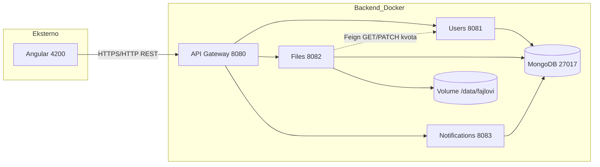

# Dijagram arhitekture — zahtev 2.1 (US-2.1.1)

Kopiraj Mermaid u [https://mermaid.live](https://mermaid.live) i exportuj PNG ako želiš da zameniš `arhitektura-sistema.png`.

## Arhitektura komponenti

## Lista portova (za odbranu)

| Port | Servis |
|------|--------|
| 4200 | Angular |
| 8080 | API Gateway |
| 8081 | Users |
| 8082 | Files |
| 8083 | Notifications |
| 27017 | MongoDB |

## Mongo — logičke baze

| Baza | Servis | Kolekcije |
|------|--------|-----------|
| `users_db` | Users | `korisnici`, `zahtevi_kvota` |
| `files_db` | Files | `folderi`, `datoteke` |
| `notifications_db` | Notifications | `notifikacije` |
