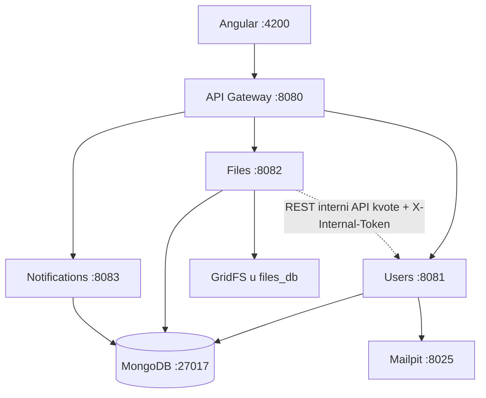

# Arhitektura sistema — dijagram komponenti

Pregled arhitekture (detaljni modeli podataka i atributi po servisu: u root [`README.md`](../README.md), sekcije *Arhitektura* i *Model podataka*).

## Dijagram

Angular šalje sve REST pozive na gateway (`:8080`). Gateway prosleđuje na mikroservise. Files ne piše direktno u users bazu — kvotu menja pozivom na interni users API.

## Portovi

| Port | Komponenta |
|------|------------|
| 4200 | Angular (u Dockeru: nginx) |
| 8080 | API Gateway |
| 8081 | Users |
| 8082 | Files |
| 8083 | Notifications |
| 27017 | MongoDB |
| 8025 | Mailpit (web) |
| 1025 | Mailpit (SMTP) |

## MongoDB — baze i kolekcije

Jedan Mongo proces, odvojene baze po servisu.

| Baza | Servis | Kolekcije / skladište |
|------|--------|------------------------|
| `users_db` | Users | `users`, `zahtevi_kvota` |
| `files_db` | Files | `folderi`, `datoteke`, GridFS (sadržaj fajlova) |
| `notifikacije_db` | Notifications | `notifikacije` |

## Gateway — rutiranje

| Prefiks | Servis |
|---------|--------|
| `/api/users/**` | Users |
| `/api/folderi/**` | Files |
| `/api/fajlovi/**` | Files |
| `/api/notifikacije/**` | Notifications |

## Komunikacija (rezime)

| Od | Ka | Način |
|----|-----|--------|
| Angular | Gateway | Sinhron REST (JSON; multipart za upload) |
| Gateway | Mikroservisi | Prosleđivanje HTTP |
| Files | Users | Sinhron REST, `POST /api/internal/kvota/{id}/promeni` |
| Users | Mailpit | SMTP (kodovi na mail) |
| Mikroservisi | MongoDB | Driver, svaki u svoju bazu |